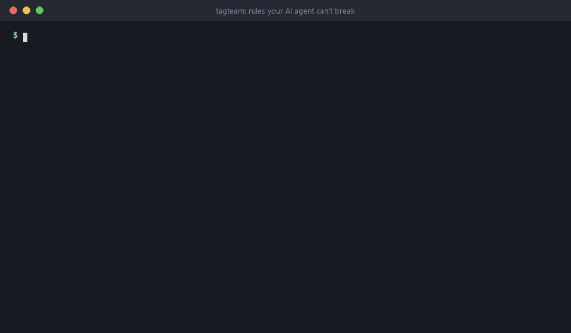

# tagteam

[](https://www.npmjs.com/package/tagteam-ai) [](https://github.com/MHRabea/tagteam/actions/workflows/ci.yml) [](LICENSE) [](https://github.com/MHRabea/tagteam)

**When your AI coding agent stops mid-task, the next one picks up from the exact next step, and is told what changed since. Rules you set are enforced: in the session, at handover, and in CI.**

Claude Code hits its usage limit. tagteam saves a structured handoff (task, what's done, the ONE next step, rules, test status), stamps it with the git state, and starts your next agent with it: Claude Code on another provider like DeepSeek, Codex, or any command. If the code changed in between, the next agent is warned before it trusts the handoff.

```powershell
npm i -g tagteam-ai
tagteam profile add claude
tagteam profile add deepseek --key      # or any provider you already pay for
tagteam --auto-switch                   # on a usage limit, continue on the next profile by itself
```


<sub>The agent sessions are shown as one-line captions. Everything else is real tagteam output, including the handoff written by Grok.</sub>

If tagteam saves you from re-explaining a project, a ⭐ on GitHub helps other developers find it.

### The loop, without you doing anything

1. You run `tagteam` instead of `claude`. The agent starts with the saved context: task, next action, rules, drift warnings.
2. The session ends: usage limit, crash, closed window, or you just want a second opinion.
3. **A handoff is always saved.** The agent writes it (`/handoff`, MCP, or the auto-save on `/compact` and exit). If it couldn't, a cheap model from your other profiles writes it from the redacted transcript and diff. If every provider is down, tagteam still saves the git state and your last messages.
4. **The handoff is checked.** Missing pieces ("no test status", "next action is vague") are reported to the agent while it can still fix them, and to the next one.
5. **The next agent starts.** tagteam proposes the next profile in your chain, or with `--auto-switch` starts it by itself when the session ended on a usage limit.
6. **It continues from the next step**, with a warning if commits or edits happened since the handoff.

Your own keys and logins only: tagteam never shares, stores or switches subscription logins.

---

## Why

Long AI coding sessions get lost in four common ways:

- **Compaction:** the agent summarizes 200 messages and forgets the one rule that mattered.
- **A new session:** you explain the project again.
- **Switching agents:** none of the context comes with you.
- **Stale summaries:** "continue where you left off" points at code that changed an hour ago.

tagteam fixes all four with a small local CLI.

## What makes it different

| | Native resume | Memory / rules files | Provider switchers | **tagteam** |
|---|:-:|:-:|:-:|:-:|
| Works across different agents (Claude Code, Codex, any MCP client) | – | partial | – | ✅ |
| **Drift detection:** warns when the repo changed since the handoff | – | – | – | ✅ |
| **Handoff check:** tells the agent what its handoff is missing, while it can still fix it | – | – | – | ✅ |
| Handoff written even when the agent hit its limit or crashed | – | – | – | ✅ |
| **Auto-switch** to the next agent on a detected usage limit (opt-in) | – | – | partial | ✅ |
| **Guardrails:** rules bound to file paths, checked against your diff | – | – | – | ✅ |
| **Edits to protected paths blocked during the session** (Claude Code) | – | – | – | ✅ |
| **Claimed vs actual:** re-runs the handoff's tests and tells the next agent if "pass" was false | – | – | – | ✅ |
| **Team rules in CI:** the same rules fail a pull request (GitHub Action) | – | – | – | ✅ |
| Nothing added to your repo (unless you opt in to shared rules) | ✅ | – | ✅ | ✅ |
| Secrets redacted before anything is saved | n/a | – | n/a | ✅ |

### Drift detection

Every handoff records the branch, HEAD and dirty files. When the next session starts, tagteam compares that state with the repo:

```
## ⚠ Drift since handoff — verify before trusting it
- 2 new commit(s) since the handoff, touching 3 file(s): src/billing.js, test/billing.test.js, package.json.
- Uncommitted changes differ from the handoff. Newly modified: src/gateway.js.
```

### Guardrails: blocked in the session, flagged at handover, failed in CI

```powershell
tagteam constraint "Do not change the payment gateway interface" --paths "src/payments/gateway.*"
```

One rule, three layers:



<sub>Recorded from a real headless Claude Code session (2.1.330) with tagteam's hook; the agent's reply is quoted as written, with the proposed code cut.</sub>

1. **During the session (prevention).** In Claude Code, tagteam's `PreToolUse` hook refuses the edit before it happens and tells the agent why. Tested with real Claude Code: the file stays untouched, and the agent stops and asks you instead of working around it:
   > I didn't change the file, because a tagteam guard hook blocked the edit: `src/payments/**` is protected by the rule "Do not change the payment gateway"…
2. **At handover (detection).** Every agent sees the rule at session start, and `tagteam status` flags any diff that touches those paths (exit code 2). This also catches writes the hook can't see, such as shell commands, and agents without hooks (Codex).
3. **In CI (gate).** `tagteam check` and the GitHub Action fail a pull request that touches the path (below).

Need to change a protected file yourself? `tagteam guard off` (per repo), make the change, `tagteam guard on`. A rule saved with `--warn-only` warns but never blocks.

### Team rules that also guard your pull requests

Add `--shared` and the rule goes into `.tagteam/constraints.json` in the repo (the only file tagteam ever writes there, and only when you ask). Commit it: every teammate's agent gets the rule, and CI enforces it.

```powershell
tagteam constraint "Payments code changes need a review from the payments team" --paths "src/payments/**" --shared
tagteam check --base main     # files changed on this branch vs the rules; exit 2 on a hit
```

On GitHub, add the action to any workflow. A pull request that touches a protected path fails, with an annotation on each file:

```yaml
on: pull_request
jobs:
  guardrails:
    runs-on: ubuntu-latest
    steps:
      - uses: actions/checkout@v4
        with:
          fetch-depth: 0
      - uses: MHRabea/tagteam@v0.3.1
```

The same rule your AI agent was told about at session start is the one your CI checks, so an agent (or a person) can't quietly change a file you protected.

### A handoff that survives rate limits

When an agent exits without saving a handoff (limit hit, crash, window closed), a cheap model from one of your other profiles writes it. That model gets the redacted transcript and the diff. If no other profile has a key, tagteam saves the git state and your last messages.

### Auto-switch on a usage limit

`tagteam --auto-switch` (or `"autoSwitch": true` in `~/.tagteam/profiles.json`) starts the next profile by itself when the session ended on a usage or rate limit. tagteam reads it from the end of the agent's own transcript (Claude Code's limit and API-error messages, Codex error events), not from guesses: a session that merely talks about rate limits never triggers it. Each profile is skipped at most once per run, so if every provider is limited, tagteam stops and asks.

### Claimed vs actual: `tagteam verify`

A handoff that says "tests: pass" is a claim. `tagteam verify` re-runs the handoff's own test command and compares:

```
Handoff 2026-11-28T09-12-03-120Z claims tests: pass
Command from the handoff: npm test
Run this command in the repo? [y/N] y
...
✗ tagteam verify: claimed pass, but the tests FAIL now. The next agent will see this result.
```

The next agent's context then says what was actually re-run and what it returned, instead of the previous agent's word for it. A test result that was never re-run is labelled as a claim. The command comes from a handoff an agent wrote, so tagteam shows it and asks before running it (`--yes` to skip the prompt for commands you trust), and never runs it on its own.

### Handoff check

A handoff with "next: continue" is not a handoff. tagteam checks each one for a task, ONE concrete next action, test status and listed progress. When the agent saves through MCP, it gets the gaps back immediately ("No test status: the next agent cannot tell whether the code currently passes") and can save again. The next agent sees any remaining gaps, and so does `tagteam status`. The check is advisory: it never fails a build.

## How it works

```
tagteam ──▶ agent (Claude Code / Codex / custom)
   │           │  SessionStart hook / first prompt ◀── context pack (task, next action, constraints, drift)
   │           │  MCP tool save_handoff ──────────────▶ handoff.json (git-stamped, redacted)
   │           ▼
   └── on exit: handoff saved? no → summarizer (another provider) → fallback: git state
        usage limit + --auto-switch? → start the next profile
        otherwise: Continue with "deepseek"? [Enter]
```

- **Claude Code:** hooks and MCP are passed with `--settings` and `--mcp-config`. Nothing is written into your repo.
- **Codex:** the provider and MCP server are passed with `-c` overrides. Your `~/.codex/config.toml` is untouched.
- **Any agent:** a `custom` profile gets the context as a file. Any MCP client can use `tagteam mcp`.

## Profiles

```powershell
tagteam profile add claude              # Claude Code, your normal login (no key stored)
tagteam profile add deepseek            # Claude Code on DeepSeek's Anthropic-compatible API
tagteam profile add openai              # Codex on the OpenAI API
tagteam chain claude,deepseek,openai
```

| Preset | Runs as | Provider | Tested live (2026-11) |
|---|---|---|---|
| `claude` | Claude Code | your normal login | ✅ hooks + MCP |
| `claude-api` | Claude Code | Anthropic API key (separate from a Claude plan) | key ok (no API credit to run) |
| `codex` | Codex | your ChatGPT login (`codex login`) | not run yet |
| `deepseek` | Claude Code | `api.deepseek.com/anthropic` | ✅ two-session task with handoffs |
| `openai` | Codex | OpenAI Responses API | config ok (no credit to run) |
| `grok` | summarizer only | xAI | ✅ summarizer (as an agent: rejected by Claude Code and Codex today) |
| `gemini` | summarizer only | Gemini OpenAI-compatible API | key ok, API returned 503 under load |

Summarizer-only profiles never run as agents. They write handoffs when an agent stops without one, and tagteam moves on to the next summarizer if one fails.

Other providers:

```powershell
tagteam profile add router --agent claude --base-url https://openrouter.ai/api --model <model>
tagteam profile add mine   --agent codex  --base-url https://my-provider/v1 --model <model>
tagteam profile add other  --agent custom --command "my-agent --prompt-file {context_file}"
```

## Commands

| Command | |
|---|---|
| `tagteam` / `tagteam run [profile]` | Start an agent with the saved context. On exit, save a handoff and offer the next profile. `--auto-switch`: move on by itself after a usage limit |
| `tagteam status` | Drift, guardrail and completeness report (exit 2 on drift or a guardrail hit) |
| `tagteam guard [on\|off]` | Show the blocking rules, or turn the edit guard off and on for this repo |
| `tagteam verify [--yes]` | Re-run the handoff's test command and compare with what it claims (exit 2 on a false pass) |
| `tagteam check [--base ref]` | For CI and pre-push: files changed on the branch vs the rules (exit 2 on a hit). Needs no saved handoff |
| `tagteam doctor` | Check node, git, agents, keys and the repo (exit 1 on problems) |
| `tagteam resume` | Print the context pack |
| `tagteam log` / `tagteam show [id]` | Handoff history |
| `tagteam constraint` / `tagteam decision` | Add a rule (`--shared`: for the whole team, in the repo) or record a decision |
| `tagteam install claude\|codex\|cursor` | Permanent per-repo wiring, if you run agents without `tagteam` |
| `tagteam mcp` | MCP server: `get_context`, `save_handoff`, `add_decision`, `add_constraint`, `update_memory`, `list_handoffs` |

In Claude Code, `/handoff` saves a handoff written by the agent itself, and the `tagteam` skill tells the agent when to use tagteam on its own: check drift at session start, record rules and decisions as they come up, save a handoff before it stops, and run `tagteam status` before committing. `tagteam run` installs both at user level (`~/.claude/commands/handoff.md`, `~/.claude/skills/tagteam/SKILL.md`) and never overwrites files of your own with the same name. The skill is plain [templates/skill/SKILL.md](templates/skill/SKILL.md), so any agent that reads Agent Skills can use it.

## Security and privacy

- **Local-first:** data lives in `~/.tagteam/` and never enters your repo. The one exception is opt-in: `--shared` rules go to `.tagteam/constraints.json` so you can commit them.
- **Keys:** kept in the OS key store: Windows DPAPI, macOS Keychain or Linux Secret Service (`secret-tool`). `profiles.json` holds only ciphertext or a reference. A key reaches the agent only through an environment variable, never as an argument.
- **Logins:** tagteam never reads, stores or switches subscription logins. The `claude` profile uses Claude Code's own login.
- **Redaction:** API keys, tokens, passwords, private keys and credentials in URLs are redacted before anything is saved or sent.
- **Summarizer:** it is the only network call tagteam makes. Turn it off with `--no-summary`.

## Status

`0.3`, early. Tested live on Windows (including the edit guard with real Claude Code); CI runs the test suite (109 tests, with fake agents and a mock provider) on Windows, macOS and Linux. Saves are locked per repo, so two agents or hooks saving at once never overwrite each other. See [SECURITY.md](SECURITY.md) and [CHANGELOG.md](CHANGELOG.md).

Roadmap:
- VS Code status bar
- cost per task
- team handoffs (shared rules shipped in 0.2)

## License

Apache-2.0 © 2026 [Mahmoud Rabea](https://mahmoudrabea96.com) · [GitHub](https://github.com/MHRabea) · [LinkedIn](https://www.linkedin.com/in/mahmoud-rabea-5b7875285). "tagteam" and its logo are not covered by the license. See [NOTICE](NOTICE).
