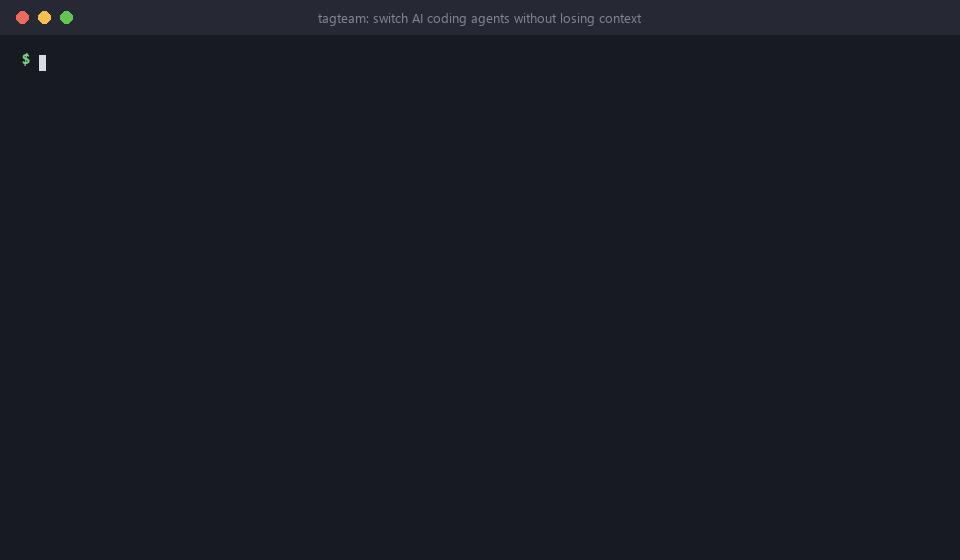

# tagteam

**Switch AI coding agents in the middle of a task without losing context, and know when a handoff is stale.**

Start a task in Claude Code, continue it on DeepSeek, finish it in Codex. tagteam keeps one git-verified handoff and loads it into whichever agent comes next.

```powershell
npm i -g tagteam-ai
tagteam profile add claude
tagteam
```



<sub>The agent sessions are shown as one-line captions. Everything else is real tagteam output, including the handoff written by Grok.</sub>

---

## Why

Long AI coding sessions get lost in four common ways:

- **Compaction:** the agent summarizes 200 messages and forgets the one rule that mattered.
- **A new session:** you explain the project again.
- **Switching agents:** none of the context comes with you.
- **Stale summaries:** "continue where you left off" points at code that changed an hour ago.

tagteam fixes all four with a small local CLI.

## What makes it different

| | Native resume | Memory / rules files | Provider switchers | **tagteam** |
|---|:-:|:-:|:-:|:-:|
| Works across different agents (Claude Code, Codex, any MCP client) | – | partial | – | ✅ |
| **Drift detection:** warns when the repo changed since the handoff | – | – | – | ✅ |
| **Guardrails:** constraints bound to file paths, checked against your diff | – | – | – | ✅ |
| Handoff written even when the agent hit its limit | – | – | – | ✅ |
| Nothing added to your repo | ✅ | – | ✅ | ✅ |
| Secrets redacted before anything is saved | n/a | – | n/a | ✅ |

### Drift detection

Every handoff records the branch, HEAD and dirty files. When the next session starts, tagteam compares that state with the repo:

```
## ⚠ Drift since handoff — verify before trusting it
- 2 new commit(s) since the handoff, touching 3 file(s): src/billing.js, test/billing.test.js, package.json.
- Uncommitted changes differ from the handoff. Newly modified: src/gateway.js.
```

### Guardrails

```powershell
tagteam constraint "Do not change the payment gateway interface" --paths "src/payments/gateway.*"
```

Every agent sees the rule at session start. `tagteam status` flags any diff that touches those paths and exits with code 2, so you can use it in CI or as a pre-commit hook.

### A handoff that survives rate limits

When an agent exits without saving a handoff (limit hit, crash, window closed), a cheap model from one of your other profiles writes it. That model gets the redacted transcript and the diff. If no other profile has a key, tagteam saves the git state and your last messages.

## How it works

```
tagteam ──▶ agent (Claude Code / Codex / custom)
   │           │  SessionStart hook / first prompt ◀── context pack (task, next action, constraints, drift)
   │           │  MCP tool save_handoff ──────────────▶ handoff.json (git-stamped, redacted)
   │           ▼
   └── on exit: handoff saved? no → summarizer (another provider) → fallback: git state
        then: Continue with "deepseek"? [Enter]
```

- **Claude Code:** hooks and MCP are passed with `--settings` and `--mcp-config`. Nothing is written into your repo.
- **Codex:** the provider and MCP server are passed with `-c` overrides. Your `~/.codex/config.toml` is untouched.
- **Any agent:** a `custom` profile gets the context as a file. Any MCP client can use `tagteam mcp`.

## Profiles

```powershell
tagteam profile add claude              # Claude Code, your normal login (no key stored)
tagteam profile add deepseek            # Claude Code on DeepSeek's Anthropic-compatible API
tagteam profile add openai              # Codex on the OpenAI API
tagteam chain claude,deepseek,openai
```

| Preset | Runs as | Provider | Tested live (2026-11) |
|---|---|---|---|
| `claude` | Claude Code | your normal login | ✅ hooks + MCP |
| `claude-api` | Claude Code | Anthropic API key (separate from a Claude plan) | key ok (no API credit to run) |
| `codex` | Codex | your ChatGPT login (`codex login`) | not run yet |
| `deepseek` | Claude Code | `api.deepseek.com/anthropic` | ✅ two-session task with handoffs |
| `openai` | Codex | OpenAI Responses API | config ok (no credit to run) |
| `grok` | summarizer only | xAI | ✅ summarizer (as an agent: rejected by Claude Code and Codex today) |
| `gemini` | summarizer only | Gemini OpenAI-compatible API | key ok, API returned 503 under load |

Summarizer-only profiles never run as agents. They write handoffs when an agent stops without one, and tagteam moves on to the next summarizer if one fails.

Other providers:

```powershell
tagteam profile add router --agent claude --base-url https://openrouter.ai/api --model <model>
tagteam profile add mine   --agent codex  --base-url https://my-provider/v1 --model <model>
tagteam profile add other  --agent custom --command "my-agent --prompt-file {context_file}"
```

## Commands

| Command | |
|---|---|
| `tagteam` / `tagteam run [profile]` | Start an agent with the saved context. On exit, save a handoff and offer the next profile |
| `tagteam status` | Drift and guardrail report (exit 2 on warnings) |
| `tagteam doctor` | Check node, git, agents, keys and the repo (exit 1 on problems) |
| `tagteam resume` | Print the context pack |
| `tagteam log` / `tagteam show [id]` | Handoff history |
| `tagteam constraint` / `tagteam decision` | Add a rule or record a decision |
| `tagteam install claude\|codex\|cursor` | Permanent per-repo wiring, if you run agents without `tagteam` |
| `tagteam mcp` | MCP server: `get_context`, `save_handoff`, `add_decision`, `add_constraint`, `update_memory`, `list_handoffs` |

In Claude Code, `/handoff` saves a handoff written by the agent itself, and the `tagteam` skill tells the agent when to use tagteam on its own: check drift at session start, record rules and decisions as they come up, save a handoff before it stops, and run `tagteam status` before committing. `tagteam run` installs both at user level (`~/.claude/commands/handoff.md`, `~/.claude/skills/tagteam/SKILL.md`) and never overwrites files of your own with the same name. The skill is plain [templates/skill/SKILL.md](templates/skill/SKILL.md), so any agent that reads Agent Skills can use it.

## Security and privacy

- **Local-first:** data lives in `~/.tagteam/` and never enters your repo.
- **Keys:** kept in the OS key store: Windows DPAPI, macOS Keychain or Linux Secret Service (`secret-tool`). `profiles.json` holds only ciphertext or a reference. A key reaches the agent only through an environment variable, never as an argument.
- **Logins:** tagteam never reads, stores or switches subscription logins. The `claude` profile uses Claude Code's own login.
- **Redaction:** API keys, tokens, passwords, private keys and credentials in URLs are redacted before anything is saved or sent.
- **Summarizer:** it is the only network call tagteam makes. Turn it off with `--no-summary`.

## Status

`0.1`, early. Tested live on Windows; CI runs the test suite on Windows, macOS and Linux. Saves are locked per repo, so two agents or hooks saving at once never overwrite each other. See [SECURITY.md](SECURITY.md) and [CHANGELOG.md](CHANGELOG.md).

Roadmap:
- switch automatically when an agent hits its limit
- VS Code status bar
- cost per task
- team handoffs

## License

Apache-2.0 © 2026 [Mahmoud Rabea](https://mahmoudrabea96.com) · [GitHub](https://github.com/MHRabea) · [LinkedIn](https://www.linkedin.com/in/mahmoud-rabea-5b7875285). "tagteam" and its logo are not covered by the license. See [NOTICE](NOTICE).
